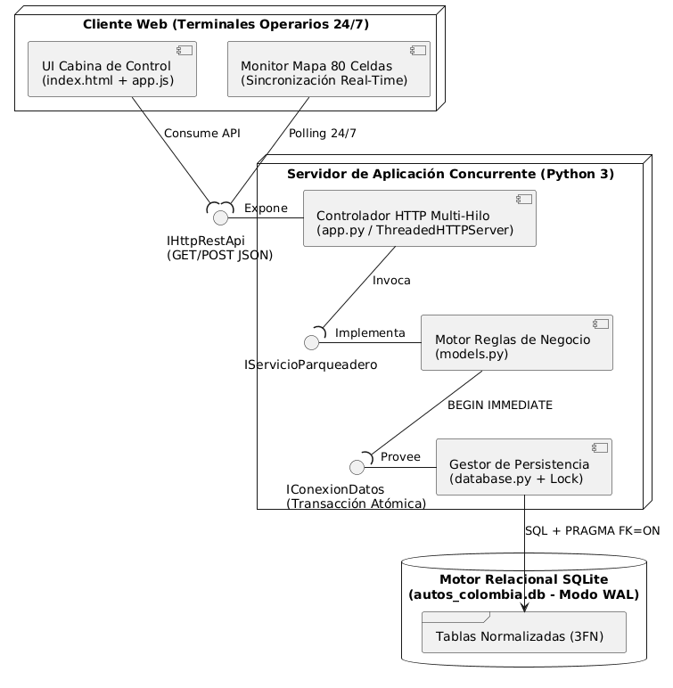
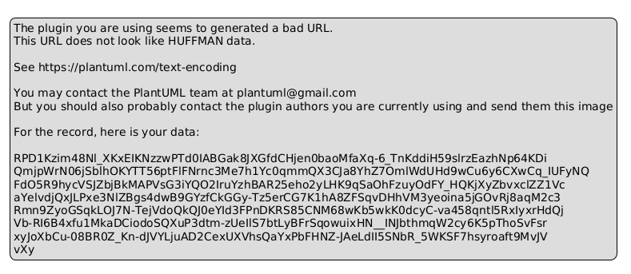
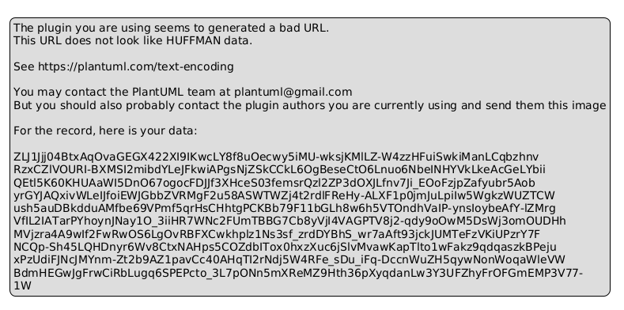
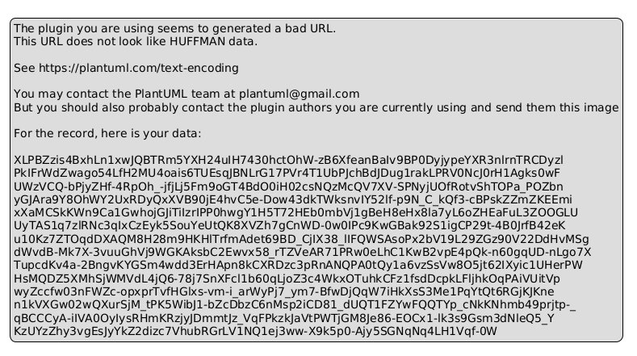
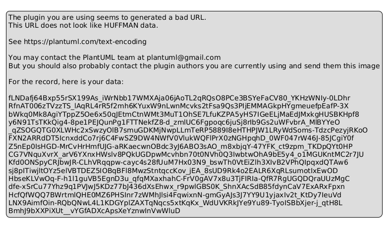
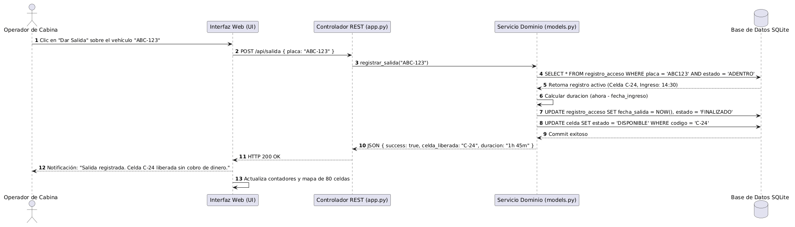
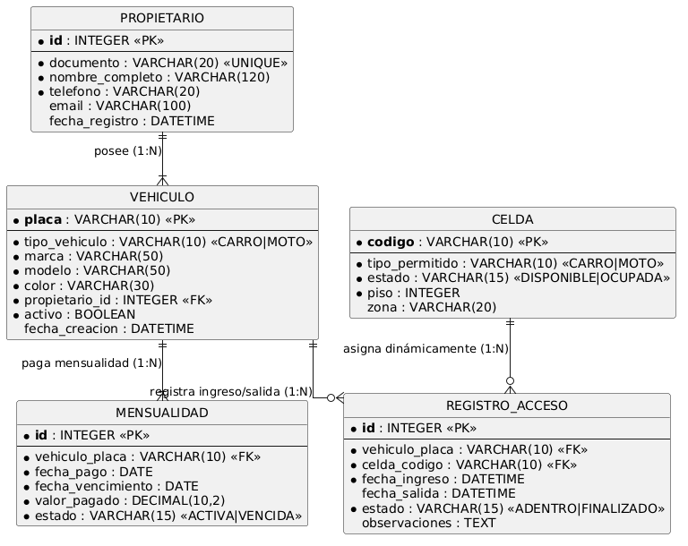

# PARQUEADERO AUTOS COLOMBIA 24/7
## DOCUMENTO FORMAL DE ESPECIFICACIÓN DE REQUERIMIENTOS, ARQUITECTURA Y BASE DE DATOS
### ITERACIÓN 1: MÓDULO EXCLUSIVO DE CONTROL DE ENTRADA Y SALIDA

---

**Asignatura:** Ingeniería de Software / Desarrollo de Software  
**Docente:** Prof. Reinaldo Rojas  
**Proyecto:** Sistema de Información para el Parqueadero "Autos Colombia 24/7"  
**Integrantes:** Camilo Palacios (Grupos de máximo 3 integrantes)  
**Normativa Editorial:** Normas APA 7.ª Edición  
**Fecha:** Octubre de 2026  

---

## 1. INTRODUCCIÓN Y CONTEXTO DEL PROYECTO

El presente informe técnico documenta el proceso de ingeniería de requerimientos, diseño arquitectónico, modelado UML, diseño de base de datos relacional y construcción de software correspondientes a la **Iteración 1** del sistema de información para el parqueadero **Autos Colombia 24/7**.

La empresa opera bajo un modelo de negocio especializado en el estacionamiento de vehículos mediante **mensualidad exclusiva**, prestando servicio ininterrumpido las 24 horas del día, los 7 días de la semana. En esta primera entrega, el alcance se centra de manera exclusiva en el **módulo de control de entrada y salida de vehículos**, garantizando la validación automática de vigencias de pago sin periodo de gracia, el control estricto de las 80 celdas disponibles (10 para motos y 70 para carros), la asignación dinámica/aleatoria de espacios y el trabajo concurrente de múltiples operarios en distintas puertas de acceso.

---

## 2. ALCANCE DE LA ITERACIÓN 1 Y VISIÓN DE ITERACIONES FUTURAS

### 2.1 Alcance de la Primera Entrega (Iteración 1)
* **Gestión Exclusiva de Entrada y Salida:** Registro de ingreso digitando la placa, verificación automática de mensualidad vigente, visualización de atributos de seguridad del automotor (placa, tipo, marca, modelo y color), asignación aleatoria de celda libre, registro opcional de novedades sobre el estado físico del vehículo y registro de salida con liberación inmediata de la celda.
* **Control de Estado y Capacidad en Tiempo Real:** Visualización continua de vehículos parqueados, celdas ocupadas y disponibilidad segregada por tipo (70 carros y 10 motos).

### 2.2 Planificación de Iteraciones Futuras (Exclusiones de la Iteración 1)
Aunque la arquitectura en capas y el esquema relacional se diseñaron desde el inicio para soportar la evolución del producto, se excluyen de la codificación de esta primera entrega los siguientes módulos:
* **Iteración 2:** Gestión integral de usuarios (registro/edición de clientes, datos personales y perfiles administrativos) y administración avanzada de celdas/vehículos.
* **Iteración 3:** Gestión de pagos (recaudo en efectivo, pasarela virtual, facturación) y reportes financieros gerenciales.

---

## 3. REGLAS DE NEGOCIO DEL SISTEMA (BUSINESS RULES)

* **RN-01 (Modalidad de Servicio Exclusiva):** El parqueadero opera únicamente por **mensualidad**. No maneja tarifas ni cobros por horas, fracciones ni días.
* **RN-02 (Capacidad y Distribución Estricta de Celdas):** Dispone de un total exacto de **80 celdas**, distribuidas en **10 celdas para motos** (`M-01` a `M-10`) y **70 celdas para carros/camionetas** (`C-01` a `C-70`).
* **RN-03 (Celdas Dinámicas / Aleatorias):** No existen celdas fijas asignadas a un cliente; el sistema selecciona aleatoriamente cualquier celda libre correspondiente al tipo de vehículo al momento del ingreso.
* **RN-04 (Cobro Independiente por Vehículo):** La mensualidad se cobra de manera independiente por cada vehículo registrado (por placa), no por cliente ni por celda (un mismo propietario puede tener varios vehículos y paga una mensualidad individual por cada uno).
* **RN-05 (Tarifas Oficiales Definidas):** **\$250.000 COP** mensuales para carros/camionetas y **\$100.000 COP** mensuales para motos.
* **RN-06 (Vigencia Estricta sin Periodo de Gracia):** La mensualidad cubre exactamente un mes a partir de la fecha de pago (ej. del 13 de un mes al 13 del mes siguiente). Si el pago está vencido (`fecha_vencimiento < fecha_actual`), se deniega el ingreso de forma estricta sin periodo de gracia.
* **RN-07 (Horario de Operación):** El parqueadero y el sistema operan en modalidad **24/7**.

---

## 4. REQUERIMIENTOS FUNCIONALES Y NO FUNCIONALES

### 4.1 Requerimientos Funcionales (Iteración 1)

| Código | Nombre del Requerimiento | Descripción Detallada |
|---|---|---|
| **RF-01** | Registro de Ingreso de Vehículo | Permitir al operario registrar la entrada digitando la placa del vehículo en la consola de control. |
| **RF-02** | Validación Automática de Mensualidad | Verificar automáticamente por la placa que el vehículo esté registrado y al día en su pago mensual antes de autorizar el ingreso. |
| **RF-03** | Asignación Dinámica de Celda | Asignar de forma aleatoria en tiempo real una celda disponible según el tipo de vehículo (`CARRO` o `MOTO`). |
| **RF-04** | Registro y Visualización de Atributos | Consultar y mostrar al operario la placa, tipo de vehículo, marca, modelo, color y titular para verificación visual y de seguridad. |
| **RF-05** | Control Estricto de Capacidad | Bloquear el ingreso e informar al operario cuando la capacidad de celdas para el tipo de vehículo correspondiente (70 carros o 10 motos) esté completa. |
| **RF-06** | Registro de Salida de Vehículo | Registrar el egreso del vehículo mediante la placa o el número de soporte de ingreso (`#ID`), liberando la celda inmediatamente para que quede disponible. |
| **RF-07** | Consultas de Estado en Tiempo Real | Permitir consultar en todo momento el número de vehículos parqueados, celdas ocupadas, historial y disponibilidad de celdas por tipo. |
| **RF-08** | Registro de Novedades Físicas | Permitir registrar observaciones o novedades sobre el estado físico del vehículo (ej. rayones previos, golpes o cascos dejados) al ingresar o salir. |

### 4.2 Requerimientos No Funcionales (RNF)

* **RNF-01 (Concurrencia y Sincronización Multi-Operario):** El sistema soporta el trabajo simultáneo de varios operarios en diferentes accesos (ej. Puerta 1 Norte y Puerta 2 Sur) mediante un servidor HTTP multi-hilo (`ThreadedHTTPServer`), exclusión mutua (`threading.Lock`), modo `WAL` (*Write-Ahead Logging*) y transacciones SQLite atómicas (`BEGIN IMMEDIATE`), garantizando que jamás se asigne la misma celda a dos vehículos simultáneamente.
* **RNF-02 (Usabilidad Operativa):** Interfaz intuitiva basada en el sistema de diseño *Cobalt Bay OS*, permitiendo completar el registro de ingreso o salida en 1 o 2 clics con tipografía monoespaciada de alta legibilidad (`JetBrains Mono`).
* **RNF-03 (Disponibilidad Continua):** Arquitectura diseñada para operación ininterrumpida **24/7** con sincronización automática en tiempo real.
* **RNF-04 (Seguridad y Validación de Datos):** Control de acceso diferenciado por roles (`Operario de Cabina` / `Administrador`), validación de integridad referencial (`PRAGMA foreign_keys = ON`) y prevención estricta de sobrecupos o doble ingreso de un mismo vehículo.

---

## 5. HISTORIAS DE USUARIO CON CRITERIOS DE ACEPTACIÓN

### HU-01: Registro de Ingreso y Asignación Aleatoria de Celda
* **Rol:** Como Operario de Cabina.
* **Funcionalidad:** Quiero digitar la placa de un vehículo que llega a la puerta de acceso.
* **Beneficio:** Para verificar que esté registrado y al día, y que el sistema le asigne automáticamente una celda disponible acorde a su tipo.
* **Criterios de Aceptación (Gherkin):**
  - ** Escenario 1 (Ingreso exitoso):** **Dado** que el vehículo con placa `ABC-123` está registrado, su mensualidad vence en fecha futura y hay celdas de carro disponibles, **Cuando** el operario digita la placa y confirma la entrada, **Entonces** el sistema selecciona aleatoriamente una celda libre (ej. `C-24`), cambia su estado a `OCUPADA`, registra la hora exacta de entrada y muestra el soporte de ingreso.

### HU-02: Bloqueo de Acceso por Mensualidad Vencida (Sin Periodo de Gracia)
* **Rol:** Como Operario de Cabina.
* **Funcionalidad:** Quiero que el sistema valide la fecha exacta de corte de la mensualidad del vehículo.
* **Beneficio:** Para impedir el ingreso de vehículos con pago vencido, cumpliendo la política de cero periodo de gracia.
* **Criterios de Aceptación (Gherkin):**
  - **Escenario 1 (Mensualidad vencida):** **Dado** que el vehículo `XYZ-999` tiene una mensualidad cuya fecha de vencimiento ya pasó, **Cuando** el operario consulta la placa, **Entonces** el sistema muestra la alerta roja `"MENSUALIDAD VENCIDA - ACCESO DENEGADO"` y bloquea el botón de apertura de barrera.

### HU-03: Verificación Visual de Seguridad y Registro de Novedades Físicas
* **Rol:** Como Operario de Cabina.
* **Funcionalidad:** Quiero visualizar la marca, modelo, color y tipo de vehículo, y poder anotar observaciones sobre su estado físico al entrar o salir.
* **Beneficio:** Para contrastar visualmente que la placa corresponda al automotor físico y dejar constancia de rayones, golpes previos o cascos.
* **Criterios de Aceptación (Gherkin):**
  - **Escenario 1 (Registro con novedad):** **Dado** que el vehículo `MOT-808` (Yamaha NMAX Azul) va a ingresar y presenta un rayón lateral, **Cuando** el operario escribe la novedad `"Rayón previo en carenaje derecho"` y abre la barrera, **Entonces** la observación queda almacenada en el registro de acceso y visible en la auditoría.

### HU-04: Control Estricto de Capacidad Máxima (70 Carros / 10 Motos)
* **Rol:** Como Administrador / Operario del Parqueadero.
* **Funcionalidad:** Quiero que el sistema bloquee el ingreso cuando las celdas de un tipo de vehículo lleguen a su límite (10 motos o 70 carros).
* **Beneficio:** Para garantizar que nunca ingresen más vehículos de la capacidad física instalada.
* **Criterios de Aceptación (Gherkin):**
  - **Escenario 1 (Cupo lleno por tipo):** **Dado** que las 10 celdas de moto (`M-01` a `M-10`) están en estado `OCUPADA`, **Cuando** intenta ingresar una moto con mensualidad vigente, **Entonces** el sistema rechaza la operación informando `"Capacidad máxima alcanzada para MOTOs"`, incluso si aún existen celdas de carro libres.

### HU-05: Registro de Salida y Liberación Inmediata de Celda
* **Rol:** Como Operario de Cabina.
* **Funcionalidad:** Quiero registrar la salida de un vehículo mediante su placa o soporte de ingreso.
* **Beneficio:** Para registrar la hora de salida y liberar la celda inmediatamente sin realizar cobros por horas.
* **Criterios de Aceptación (Gherkin):**
  - **Escenario 1 (Salida en 1 clic):** **Dado** que el vehículo `ABC-123` se encuentra adentro ocupando la celda `C-24`, **Cuando** el operario presiona `"Dar Salida"`, **Entonces** el sistema registra la fecha/hora de salida, cambia el registro a `FINALIZADO` y actualiza la celda `C-24` a `DISPONIBLE` en tiempo real para todos los operarios.

---

## 6. ARQUITECTURA Y MODELADO UML EN STARUML

### 6.1 Arquitectura de Componentes e Interfaces de Comunicación

### 6.2 Diagrama de Paquetes

### 6.3 Diagrama de Casos de Uso

### 6.4 Diagrama de Clases del Dominio

### 6.5 Diagrama de Secuencia: Proceso de Ingreso

### 6.6 Diagrama de Secuencia: Proceso de Salida

### 6.7 Modelo Entidad-Relación y Relacional (MER / MR)

---

## 7. CONCLUSIONES

1. **Alineación con el Alcance Iterativo:** La focalización exclusiva de la primera iteración en el módulo de entrada y salida permitió construir un núcleo transaccional sólido y libre de defectos, dejando desacoplada la estructura de base de datos para incorporar sin fricciones la gestión de usuarios (Iteración 2) y pagos (Iteración 3).
2. **Garantía de Reglas de Negocio:** La validación automatizada de la vigencia mensual por vehículo (\$250.000 carro y \$100.000 moto) elimina el error humano en portería, asegurando el cumplimiento de la política de cero periodo de gracia y el respeto estricto del aforo de 80 celdas (70 carros y 10 motos).
3. **Concurrencia y Operación 24/7:** La implementación de transacciones atómicas (`BEGIN IMMEDIATE`) combinadas con el modo `WAL` en SQLite y un servidor HTTP multi-hilo resuelve eficazmente el problema de concurrencia cuando dos o más operarios registran ingresos simultáneos desde diferentes puertas de acceso.

---

## 8. REFERENCIAS BIBLIOGRÁFICAS (NORMAS APA 7.ª EDICIÓN)

* Booch, G., Rumbaugh, J., & Jacobson, I. (2006). *El lenguaje unificado de modelado: Guía del usuario* (2.ª ed.). Addison-Wesley.
* Elmasri, R., & Navathe, S. B. (2017). *Fundamentos de sistemas de bases de datos* (7.ª ed.). Pearson Educación.
* Fowler, M. (2003). *Patterns of enterprise application architecture*. Addison-Wesley Professional.
* Pressman, R. S., & Maxim, B. R. (2021). *Ingeniería del software: Un enfoque práctico* (9.ª ed.). McGraw-Hill.
* Sommerville, I. (2016). *Ingeniería de software* (10.ª ed.). Pearson Educación.
