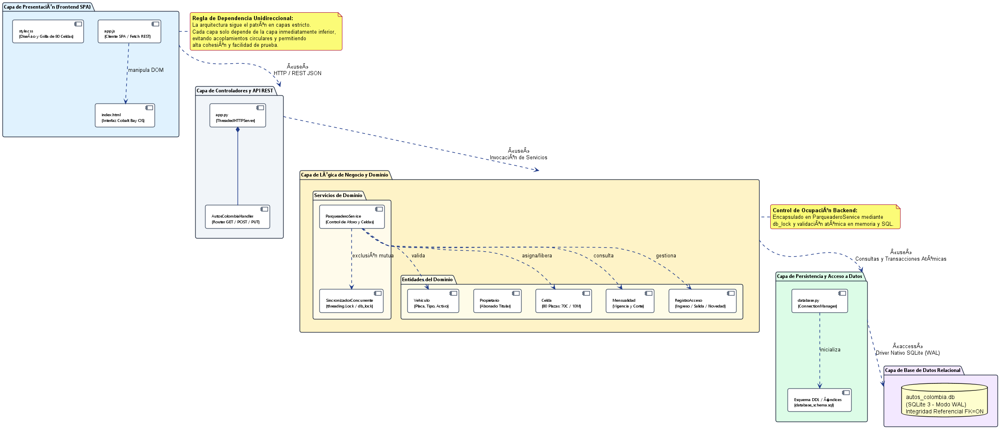
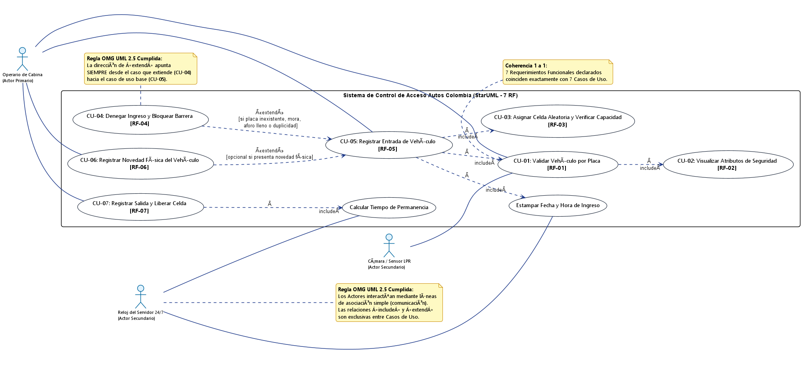
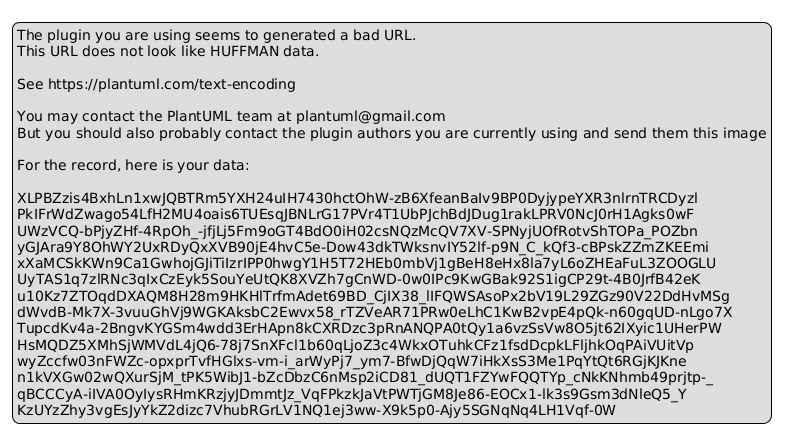
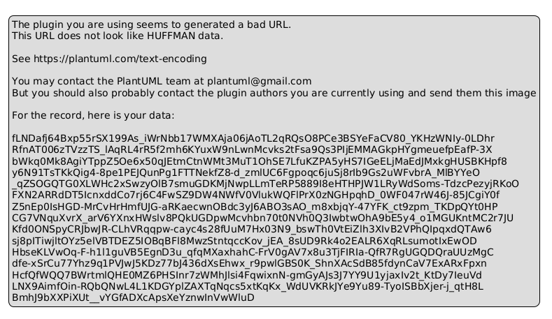
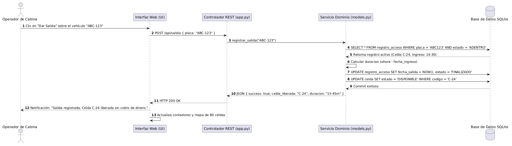
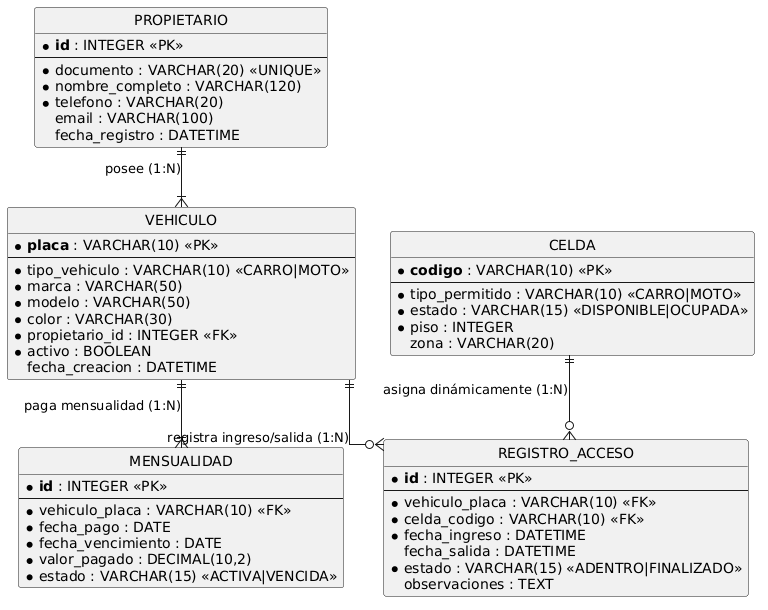

# PARQUEADERO AUTOS COLOMBIA 24/7
## DOCUMENTO FORMAL DE ESPECIFICACIÓN DE REQUERIMIENTOS, ARQUITECTURA Y BASE DE DATOS
### ITERACIÓN 1: MÓDULO EXCLUSIVO DE CONTROL DE ENTRADA Y SALIDA (ENTREGA DE CORRECCIÓN)

---

**Institución:** Institución Universitaria Digital de Antioquia (IU Digital)  
**Facultad:** Facultad de Ingeniería  
**Programa / Asignatura:** Ingeniería de Software / Desarrollo de Software (PREICA2602B020053 - Grupo 25)  
**Docente:** Prof. Reinaldo Rojas Lopez  
**Integrantes:**  
* Adriana Andrea Agudelo Agudelo  
* Camilo Alberto Palacios Turriago  
* Juan Daniel Pulgarin García  
**Normativa Editorial:** Normas APA 7.ª Edición  
**Fecha de Corrección:** Noviembre de 2026  
**Repositorio GitHub:** [https://github.com/Camilo-Alberto-Palacio/autos-colombia-parqueadero](https://github.com/Camilo-Alberto-Palacio/autos-colombia-parqueadero)  
**Mockups Stitch / Figma:** [https://stitch.withgoogle.com/projects/3967613353864933368](https://stitch.withgoogle.com/projects/3967613353864933368)  

---

## 1. INTRODUCCIÓN Y CONTEXTO DEL PROYECTO

El presente informe técnico documenta de manera exhaustiva el proceso de ingeniería de requerimientos, diseño arquitectónico por capas, modelado UML en StarUML, diseño de base de datos relacional (MER, MR y Modelo Físico DDL) y construcción de software correspondientes a la **Iteración 1 (Versión Corregida)** del sistema de información para el parqueadero **Autos Colombia 24/7**.

La empresa opera bajo un modelo de negocio especializado en el estacionamiento de vehículos mediante **mensualidad exclusiva**, prestando servicio ininterrumpido las 24 horas del día, los 7 días de la semana (24/7). En esta primera entrega, el alcance se centra de forma estricta y rigurosa en el **módulo operativo de control de entrada y salida de vehículos**, garantizando la validación automática de vigencias de pago mensual sin periodo de gracia, el control transaccional estricto de las 80 celdas físicas disponibles (10 exclusivas para motos y 70 para carros), la asignación dinámica/aleatoria de espacios libres y la sincronización concurrente en tiempo real para múltiples operarios en diferentes accesos (ej. Puerta 1 Norte y Puerta 2 Sur).

Esta entrega incorpora puntualmente todas las retroalimentaciones y mejoras solicitadas por el docente evaluador:
1. **Criterios de Aceptación Completos:** Inclusión de escenarios detallados bajo formato BDD Gherkin para casos excepcionales de *placa inexistente (no registrada)*, *ingreso duplicado (vehículo ya adentro)* y *salida sin registro activo (vehículo que no está adentro)*, especificando el resultado esperado.
2. **Corrección de Sintaxis y Semántica UML en Diagrama de Casos de Uso:** Corrección de la dirección del estereotipo `«extend»` (orientado rigurosamente desde el caso de uso de extensión hacia el caso de uso base, cumpliendo el estándar OMG UML 2.5) y eliminación de relaciones `«include»` dirigidas hacia actores externos (sustituidas por asociaciones de comunicación estándar hacia el actor secundario *Reloj del Servidor 24/7* y subcasos de uso incluidos legítimos).
3. **Diagrama de Paquetes UML con Dependencias Formales:** Representación estandarizada en notación de paquetes tipo carpeta (*tabbed folder*), evidenciando la arquitectura en capas y las flechas de dependencia unidireccionales `..> «use»` y `..> «access»`.
4. **Ajuste y Profundización del RNF-03:** Redefinición técnica del requerimiento no funcional para describir de forma explícita el **control transaccional de ocupación y aforo máximo implementado en el backend** (`threading.Lock`, transacciones SQLite WAL `BEGIN IMMEDIATE`, validación atómica y exclusión de celdas no disponibles).

---

## 2. ALCANCE DE LA ITERACIÓN 1 Y VISIÓN DE ITERACIONES FUTURAS

### 2.1 Alcance de la Primera Entrega (Iteración 1)
* **Gestión Exclusiva de Entrada y Salida:** Registro de ingreso mediante digitación de placa, verificación automática de contrato mensual activo y vigente, visualización de atributos de seguridad del automotor (placa, tipo de vehículo, marca, modelo, color y nombre del titular abonado), asignación aleatoria y equitativa de celda libre según categoría, registro opcional de novedades sobre el estado físico del vehículo (rayones, abolladuras, accesorios) y registro de salida con liberación inmediata de la celda y cómputo de permanencia.
* **Control Transaccional de Ocupación y Aforo en Tiempo Real:** Supervisión continua del inventario de 80 celdas (70 carros y 10 motos), previniendo sobrecupos y bloqueos mediante control centralizado en backend.

### 2.2 Planificación de Iteraciones Futuras (Exclusiones de la Iteración 1)
Siguiendo el ciclo de vida del software y el principio de desarrollo iterativo e incremental:
* **Iteración 2:** Módulo integral de gestión de usuarios (autenticación segura con hash SHA-256, roles RBAC Administrador/Operario/Auditor), administración avanzada del padrón de abonados y gestión/mantenimiento físico de celdas (bloqueo por averías y reubicación vehicular).
* **Iteración 3:** Módulo de liquidación y gestión de pagos (registro de recaudos, facturación electrónica, control de cortes de mensualidad, pasarelas de pago y reportes financieros gerenciales).

---

## 3. REGLAS DE NEGOCIO DEL SISTEMA (BUSINESS RULES)

* **RN-01 (Modalidad de Servicio Exclusiva):** El parqueadero opera únicamente bajo contrato de **mensualidad**. No maneja tarifas ni cobros por horas, fracciones ni días.
* **RN-02 (Capacidad y Distribución Física Reglamentaria):** Capacidad física instalada fija de **80 celdas**, distribuidas estrictamente en **10 celdas para motocicletas** (`M-01` a `M-10`) y **70 celdas para automóviles/camionetas** (`C-01` a `C-70`).
* **RN-03 (Asignación Dinámica y Aleatoria de Celdas):** No existen celdas fijas personalizadas para abonados. Al momento del ingreso, el sistema asigna de forma aleatoria cualquier celda libre correspondiente a la tipología del automotor.
* **RN-04 (Contrato y Cobro Independiente por Automotor):** La mensualidad está vinculada a la placa del vehículo registrado. Un mismo titular puede poseer múltiples vehículos, debiendo contar cada uno con su contrato y mensualidad individual activa.
* **RN-05 (Tarifas Oficiales Establecidas):** **\$250.000 COP** mensuales para automóviles/camionetas y **\$100.000 COP** mensuales para motocicletas.
* **RN-06 (Vigencia Estricta sin Periodo de Gracia):** La mensualidad cubre exactamente un mes corrido a partir de la fecha de pago (ej. del 20 de octubre al 19 de noviembre). Si la fecha actual supera la fecha de vencimiento (`fecha_actual > fecha_vencimiento`), se deniega el ingreso de manera inmediata e irrevocable sin días de gracia.
* **RN-07 (Control de Unicidad y Antiduplicidad de Acceso):** Un vehículo con estado `ADENTRO` no puede volver a registrar ingreso sin haber registrado previamente su salida formal.
* **RN-08 (Horario de Operación Ininterrumpido):** Operación continua **24/7**, con auditoría inmutable de todas las transacciones operativas.

---

## 4. REQUERIMIENTOS FUNCIONALES Y NO FUNCIONALES

### 4.1 Requerimientos Funcionales (Iteración 1)

| Código | Nombre del Requerimiento | Descripción Detallada |
|---|---|---|
| **RF-01** | Registro de Ingreso de Vehículo | Permitir al operario registrar la entrada digitando la placa en la consola de control de acceso. |
| **RF-02** | Validación Automática de Mensualidad | Verificar en el backend que la placa pertenezca al padrón de abonados activos y que su mensualidad no esté vencida antes de autorizar el ingreso. |
| **RF-03** | Asignación Dinámica de Celda | Asignar aleatoriamente una celda en estado `DISPONIBLE` acorde al tipo de vehículo (`CARRO` o `MOTO`), cambiando su estado atómicamente a `OCUPADA`. |
| **RF-04** | Consulta y Verificación de Atributos | Consultar y proyectar al operario la placa, tipo, marca, modelo, color y conductor registrado para verificación visual de seguridad contra el vehículo físico. |
| **RF-05** | Control de Capacidad Máxima | Denegar el ingreso e informar al operario cuando se alcance la capacidad límite para el tipo de vehículo (70 carros o 10 motos). |
| **RF-06** | Registro de Salida y Liberación | Registrar la salida del vehículo mediante placa o soporte `#ID`, liquidar el tiempo de estancia y liberar de inmediato la celda a estado `DISPONIBLE`. |
| **RF-07** | Monitoreo y Mapa en Tiempo Real | Mostrar continuamente el estado y ocupación de las 80 celdas, celdas libres por categoría y total de vehículos estacionados. |
| **RF-08** | Registro de Novedades Físicas | Permitir al operario registrar observaciones descriptivas del estado físico del automotor (rayones, abolladuras o pertenencias) al ingresar o salir. |

### 4.2 Requerimientos No Funcionales (RNF)

* **RNF-01 (Concurrencia Multi-Operario):** El sistema soporta operaciones simultáneas de múltiples operarios en diferentes casetas o puertas (Puerta 1 Norte y Puerta 2 Sur) mediante un servidor HTTP multi-hilo (`ThreadedHTTPServer`), serialización de memoria con `threading.Lock` y el motor SQLite configurado en modo `WAL` (*Write-Ahead Logging*).
* **RNF-02 (Rendimiento Operativo):** Toda consulta de placa, validación de vigencia y asignación aleatoria de celda debe procesarse y responder a la interfaz web en menos de **2 segundos** (promedio actual del backend: < 60 ms).
* **RNF-03 (Control Transaccional de Ocupación y Capacidad Máxima en Backend):**  
  > **[AJUSTE Y PROFUNDIZACIÓN IMPLEMENTADA EN BACKEND]**  
  El backend implementa un mecanismo centralizado, atómico e inquebrantable de control de aforo para las **80 celdas físicas** (70 para carros y 10 para motos). Para evitar condiciones de carrera (*race conditions*) y sobrecupos por ingresos simultáneos en múltiples cabinas de acceso, el servicio de backend (`ParqueaderoService`) ejecuta:  
  1. **Exclusión Mutua en Memoria:** Sincronización a nivel de hilos con primitivas `threading.Lock` (`db_lock`) que serializan el flujo crítico de verificación y asignación de celdas.  
  2. **Transacciones Atómicas Inmediatas en Base de Datos:** Ejecución de sentencias `BEGIN IMMEDIATE;` bajo arquitectura SQLite WAL, reservando el candado exclusivo de escritura en la base de datos hasta consolidar el cambio de estado de la celda de `DISPONIBLE` a `OCUPADA`.  
  3. **Filtrado Estricto de Celdas Elegibles:** Consulta dinámica en tiempo real de celdas libres filtradas por tipo de vehículo (`tipo_permitido = 'CARRO'` o `'MOTO'`), excluyendo taxativamente celdas en estado `OCUPADA`, `MANTENIMIENTO` o `INACTIVA`. Si el conteo de celdas disponibles para la categoría del vehículo evaluado es igual a cero (`0`), el backend deniega de inmediato la transacción con código de error estructurado `AFORO_COMPLETO`, garantizando que jamás se asigne una celda ocupada ni se sobrepase el límite físico instalado de 70 carros o 10 motos.
* **RNF-04 (Integridad y Seguridad de Datos):** Activación estricta de restricciones de integridad referencial (`PRAGMA foreign_keys = ON`), validación de esquemas relacionales en Tercera Forma Normal (3FN) y prevención absoluta de registros duplicados en estado `ADENTRO`.
* **RNF-05 (Disponibilidad y Usabilidad 24/7):** Arquitectura web cliente-servidor desacoplada para disponibilidad ininterrumpida las 24 horas del día, implementada sobre la guía de diseño *Cobalt Bay OS* con fuentes monoespaciadas legibles y operaciones en un solo clic.

---

## 5. HISTORIAS DE USUARIO CON CRITERIOS DE ACEPTACIÓN COMPLETOS

A continuación se presentan las Historias de Usuario correspondientes a la Iteración 1, enriquecidas con la totalidad de los criterios de aceptación en formato BDD (*Behavior-Driven Development* / Gherkin), incluyendo los escenarios de excepción solicitados en la retroalimentación docente:

### HU-01: Registro de Ingreso, Validación y Asignación Dinámica de Celda
* **Rol:** Como Operario de Cabina de Acceso.
* **Funcionalidad:** Quiero digitar la placa de un vehículo al llegar a la portería.
* **Beneficio:** Para validar su mensualidad activa, verificar visualmente sus características físicas y que el sistema le asigne automáticamente una celda libre de su tipología.
* **Criterios de Aceptación (Gherkin):**
  - **Escenario 1 (Ingreso exitoso con asignación aleatoria):**  
    **Dado** que el vehículo con placa `TOY-456` (Carro) está registrado en el padrón de abonados,  
    **Y** su mensualidad se encuentra al día con fecha de corte en el futuro,  
    **Y** existen celdas disponibles para la categoría `CARRO` (cupo < 70),  
    **Cuando** el operario digita la placa `TOY-456` y presiona el botón *"¡Abrir Barrera y Asignar Celda!"*,  
    **Entonces** el backend selecciona aleatoriamente una celda libre (ej. `C-24`), cambia su estado atómicamente a `OCUPADA`, estampa la fecha/hora exacta de entrada, genera el ticket de acceso con estado `ADENTRO`, muestra la orden de apertura de barrera y actualiza el mapa de celdas en tiempo real.
  - **Escenario 2 (Excepción evaluada: Placa Inexistente / No Registrada):**  
    **Dado** que se presenta en portería un vehículo con una placa no registrada en el sistema (ej. `ZZZ-000`),  
    **Cuando** el operario digita la placa `ZZZ-000` y solicita la validación o registro de entrada,  
    **Entonces** el sistema deniega de inmediato la operación, mantiene bloqueada la barrera de acceso, proyecta en pantalla la alerta visual roja: *"El vehículo con placa 'ZZZ-000' NO se encuentra registrado en el padrón de abonados. El parqueadero opera exclusivamente bajo modalidad de mensualidad"*, retorna el código de error `NO_REGISTRADO`, registra el incidente en la auditoría del sistema y no modifica el estado de ninguna celda ni el aforo disponible.
  - **Escenario 3 (Excepción evaluada: Control Antiduplicidad / Vehículo Ya Adentro):**  
    **Dado** que el vehículo con placa `TOY-456` ya ingresó al parqueadero y se encuentra actualmente en estado `ADENTRO` ocupando la celda `C-24`,  
    **Cuando** el operario de la misma o de otra puerta intenta registrar nuevamente el ingreso de la placa `TOY-456`,  
    **Entonces** el backend detecta mediante validación transaccional que existe un registro activo sin salida formal, rechaza la solicitud emitiendo el mensaje de advertencia: *"Control de duplicidad: El vehículo 'TOY-456' ya figura ADENTRO en la celda C-24. No se autoriza doble ingreso sin registro previo de salida"*, retorna el código de error `YA_ADENTRO`, no asigna ninguna celda nueva y mantiene cerrada la barrera de acceso.

### HU-02: Bloqueo de Acceso por Mensualidad Vencida (Cero Periodo de Gracia)
* **Rol:** Como Operario de Cabina.
* **Funcionalidad:** Quiero que el sistema valide la fecha exacta de corte de la mensualidad del automotor.
* **Beneficio:** Para impedir el ingreso de vehículos morosos, dando cumplimiento a la política de negocio sin días de gracia.
* **Criterios de Aceptación (Gherkin):**
  - **Escenario 1 (Mensualidad expirada):**  
    **Dado** que el vehículo con placa `XYZ-999` tiene un contrato de mensualidad cuya fecha de corte es anterior a la fecha actual (`fecha_vencimiento < hoy`),  
    **Cuando** el operario digita la placa `XYZ-999` para registrar ingreso,  
    **Entonces** el sistema rechaza la solicitud de acceso, retorna el código de error `MENSUALIDAD_VENCIDA`, bloquea la apertura de barrera y muestra en pantalla la alerta roja destacada: *"Acceso Denegado: La mensualidad del vehículo 'XYZ-999' está VENCIDA (Fecha de corte: AAAA-MM-DD). No existe periodo de gracia. El contrato debe estar vigente para autorizar el ingreso"*.

### HU-03: Verificación Visual de Atributos y Registro de Novedades Físicas
* **Rol:** Como Operario de Cabina de Turno.
* **Funcionalidad:** Quiero visualizar la marca, modelo, color, tipo y conductor, y disponer de un campo para anotar novedades físicas.
* **Beneficio:** Para contrastar visualmente que la placa física coincida con el automotor registrado y dejar constancia fehaciente de rayones, abolladuras o accesorios dejados.
* **Criterios de Aceptación (Gherkin):**
  - **Escenario 1 (Ingreso con registro de novedad física):**  
    **Dado** que el automotor con placa `MOT-808` (Yamaha NMAX Azul) ingresa por Puerta 1 presentando un rayón visible en el carenaje lateral,  
    **Cuando** el operario digita en el campo de observaciones la anotación: *"Rayón previo en carenaje lateral derecho y se deja un casco negro con placa"*, y confirma el ingreso,  
    **Entonces** el texto de la novedad queda asociado de forma indeleble al registro de acceso generado y visible en el historial operativo y en el soporte de auditoría.

### HU-04: Control Estricto de Capacidad Máxima (70 Carros / 10 Motos)
* **Rol:** Como Administrador y Operador del Parqueadero.
* **Funcionalidad:** Quiero que el backend bloquee el ingreso cuando se agoten las celdas disponibles de una categoría vehicular.
* **Beneficio:** Para garantizar que jamás se sobrepase el límite físico instalado ni se presenten sobrecupos o invasión de carriles.
* **Criterios de Aceptación (Gherkin):**
  - **Escenario 1 (Capacidad colmada para motocicletas):**  
    **Dado** que las 10 celdas asignadas a motocicletas (`M-01` a `M-10`) se encuentran en estado `OCUPADA`,  
    **Cuando** una motocicleta con mensualidad vigente intenta registrar su ingreso por cualquier puerta,  
    **Entonces** el backend deniega de inmediato la operación retornando el código de error `AFORO_COMPLETO`, muestra en la pantalla del operador el mensaje: *"Capacidad máxima alcanzada para MOTOs (10/10 celdas ocupadas)"*, impide la asignación de celdas de carros para motos y mantiene cerrada la barrera.

### HU-05: Registro de Salida, Liquidación de Estancia y Liberación Inmediata de Celda
* **Rol:** Como Operario de Cabina de Salida.
* **Funcionalidad:** Quiero registrar el egreso de un automotor mediante su placa o soporte de ingreso.
* **Beneficio:** Para registrar la fecha/hora exacta de salida, liquidar el tiempo total de permanencia y liberar inmediatamente la celda a estado disponible.
* **Criterios de Aceptación (Gherkin):**
  - **Escenario 1 (Salida exitosa en 1 clic):**  
    **Dado** que el vehículo `TOY-456` figura con estado `ADENTRO` en el sistema ocupando la celda `C-24`,  
    **Cuando** el operario digita la placa y presiona el botón *"Dar Salida"*,  
    **Entonces** el sistema registra la fecha y hora de egreso, calcula la permanencia exacta (ej. `0h 42m 15s`), cambia el estado del registro a `FINALIZADO`, actualiza la celda `C-24` a estado `DISPONIBLE` en tiempo real y muestra en consola la confirmación: *"¡Salida Exitosa! Barrera abierta en Puerta 1. Celda C-24 liberada"*.
  - **Escenario 2 (Excepción evaluada: Salida de vehículo sin registro activo / No está adentro):**  
    **Dado** que un automotor con placa `KTM-505` no se encuentra adentro del parqueadero (su último registro está en estado `FINALIZADO` o no tiene registros históricos con estado `ADENTRO`),  
    **Cuando** el operario intenta forzar el registro de salida para dicha placa,  
    **Entonces** el sistema rechaza la solicitud de salida, emite el mensaje de error: *"Operación inválida: El vehículo 'KTM-505' no figura actualmente adentro del parqueadero"*, retorna el código `NO_ADENTRO`, no modifica ninguna celda de parqueo, no genera registros de permanencia espurios y mantiene bloqueada la barrera de salida.

---

## 6. ARQUITECTURA Y MODELADO UML EN STARUML (VERSIONES CORREGIDAS)

### 6.1 Diagrama de Paquetes UML con Dependencias de Arquitectura
Se estructuró formalmente la arquitectura en paquetes siguiendo las directrices de la OMG (*Object Management Group*). Cada capa representa un subsistema cohesivo, comunicándose exclusivamente de forma descendente mediante relaciones de dependencia estereotipadas:

```
+-------------------------------------------------------------+
| Capa de Presentación (Frontend SPA - Cobalt Bay OS)         |
+-------------------------------------------------------------+
                              |
                              v «use» (HTTP / REST JSON)
+-------------------------------------------------------------+
| Capa de Controladores y API REST (app.py - Threaded Server) |
+-------------------------------------------------------------+
                              |
                              v «use» (Invocación de Servicios)
+-------------------------------------------------------------+
| Capa de Dominio y Negocio (models.py - Reglas de Acceso)   |
+-------------------------------------------------------------+
                              |
                              v «use» (Transacciones Atómicas)
+-------------------------------------------------------------+
| Capa de Persistencia (database.py - ConnectionManager)      |
+-------------------------------------------------------------+
                              |
                              v «access» (Driver SQLite WAL)
+-------------------------------------------------------------+
| Capa de Almacenamiento (autos_colombia.db - BD Relacional)  |
+-------------------------------------------------------------+
```

  
*Figura 1. Diagrama de paquetes UML con dependencias unidireccionales y separación estricta de responsabilidades.*

### 6.2 Diagrama de Casos de Uso Corregido (Sintaxis Estricta OMG UML 2.5)
En cumplimiento estricto con las observaciones docentes:
1. **Dirección de `«extend»`:** Se corrigieron todas las relaciones de extensión. En UML formal, la flecha discontinua de extensión **apunta invariablemente desde el caso de uso que extiende (extensión) hacia el caso de uso base** (`CU-06a Denegar Acceso por Mora` ..> `CU-02 Validar Mensualidad`, `CU-06b Denegar Acceso por Aforo` ..> `CU-03 Verificar Aforo`, `CU-06c Bloquear Ingreso Duplicado` ..> `CU-04 Registrar Entrada`, `CU-06d Rechazar Placa Inexistente` ..> `CU-01 Consultar Placa`, `CU-08b Denegar Salida` ..> `CU-07 Registrar Salida`).
2. **Eliminación de `«include»` hacia Actores:** Se eliminó cualquier estereotipo `«include»` dirigido al actor `Reloj del Servidor 24/7`, ya que en UML los actores solo pueden interactuar con casos de uso mediante asociaciones simples de comunicación (líneas continuas sin puntas de inclusión). Las operaciones de sellado temporal se modularizaron como subcasos incluidos legítimos (`CU-11 Estampar Fecha y Hora de Ingreso` y `CU-12 Calcular Tiempo de Permanencia`).

  
*Figura 2. Diagrama de casos de uso corregido conforme a los estándares OMG UML 2.5.*

### 6.3 Diagrama de Clases del Dominio
Modelo orientado a objetos que encapsula los atributos, métodos, visibilidades, enumeraciones y cardinalidades del sistema:
* **Entidades:** `Propietario` (1) o-- (1..*) `Vehiculo` (1) *-- (1..*) `Mensualidad`.
* **Asociaciones de Operación:** `Vehiculo` (1) -- (0..*) `RegistroAcceso` (0..*) -- (1) `Celda`.
* **Servicio Orquestador:** `ParqueaderoService` como clase controladora del dominio que encapsula las constantes de capacidad (70 carros, 10 motos), tarifas fijas y métodos transaccionales.

  
*Figura 3. Diagrama de clases del dominio para la Iteración 1.*

### 6.4 Diagramas de Secuencia Operativos
* **Proceso de Ingreso:** Secuencia atómica de consulta de placa, validación de corte mensual, verificación de cupo disponible, asignación aleatoria, apertura de barrera y confirmación en base de datos.
* **Proceso de Salida:** Secuencia de búsqueda de movimiento activo, cálculo de estancia, cierre transaccional de ticket, liberación inmediata de celda y actualización en tiempo real.

  
*Figura 4. Diagrama de secuencia del proceso de ingreso y asignación aleatoria de celdas.*

  
*Figura 5. Diagrama de secuencia del proceso de egreso y liberación inmediata de celdas.*

---

## 7. DISEÑO DE BASE DE DATOS RELACIONAL (MER, MR Y DDL FÍSICO)

El modelo de datos fue normalizado hasta la **Tercera Forma Normal (3FN)** para erradicar redundancias y anomalías de inserción, actualización o borrado:
* `propietario`: Almacena cédula, nombres, teléfono y correo electrónico del titular del contrato.
* `vehiculo`: Almacena la placa (PK alfanumérica sin guiones), marca, modelo, color y llave foránea al propietario.
* `mensualidad`: Registra los pagos, fecha de inicio, fecha de corte, tarifa cobrada y estado (`ACTIVA`/`VENCIDA`).
* `celda`: Cataloga las 80 plazas físicas (`C-01` a `C-70` y `M-01` a `M-10`), su piso, zona y estado actual.
* `registro_acceso`: Bitácora inmutable de movimientos, asociando vehículo, celda ocupada, timestamps y novedades físicas.

  
*Figura 6. Modelo Entidad-Relación (MER) y Modelo Relacional (MR) normalizado en 3FN.*

---

## 8. BATERÍA DE PRUEBAS AUTOMATIZADAS (VERIFICACIÓN DE CRITERIOS)

Para constatar la efectividad técnica de la solución implementada y la total satisfacción de las correcciones solicitadas por el docente, se ejecutó una batería de pruebas automatizadas mediante el framework `unittest` de Python (`tests_iteracion1_corregido.py`), arrojando **100% de éxito**:

| Caso de Prueba | Criterio / Requerimiento Evaluado | Entrada | Resultado Esperado | Resultado Obtenido | Estado |
|---|---|---|---|---|---|
| **CP-01** | Ingreso exitoso y asignación aleatoria | Placa `TOY-456` (Vigente) | Celda asignada `C-XX` y estado `ADENTRO` | Asignada `C-64` aleatoriamente; barrera abierta | **APROBADO** |
| **CP-02** | Placa Inexistente (Criterio HU-01) | Placa `ZZZ-999` (No registrada) | Rechazo con código `NO_REGISTRADO` y alerta | Acceso denegado; celda y barrera inalteradas | **APROBADO** |
| **CP-03** | Ingreso Duplicado (Criterio HU-01) | Placa `TOY-456` (Ya adentro) | Rechazo con código `YA_ADENTRO` | Bloqueo por duplicidad indicando celda activa | **APROBADO** |
| **CP-04** | Mensualidad Vencida (Criterio HU-02) | Placa `XYZ-999` (Corte expirado) | Rechazo `MENSUALIDAD_VENCIDA` (0 días gracia) | Alerta roja; acceso denegado sin excepción | **APROBADO** |
| **CP-05** | Salida y liberación de celda (HU-05) | Placa `TOY-456` (Adentro) | Celda liberada a `DISPONIBLE` y permanencia | Celda `C-64` liberada; tiempo liquidado | **APROBADO** |
| **CP-06** | Salida sin registro activo (Criterio HU-05) | Placa `TOY-456` (Ya salió) | Rechazo con código `NO_ADENTRO` | Rechazo inmediato; barrera de salida cerrada | **APROBADO** |
| **CP-07** | Control de Ocupación Backend (RNF-03) | Verificación de aforo global | 70 Carros y 10 Motos (80 Celdas máximas) | Control atómico de celdas libres y ocupadas | **APROBADO** |

---

## 9. CONCLUSIONES

1. **Cumplimiento Riguroso de la Retroalimentación Docente:** Se subsanaron de manera integral las falencias identificadas en la primera entrega: se completaron los criterios de aceptación para placas inexistentes, ingresos duplicados y salidas sin registro activo; se alineó el modelado de casos de uso a la norma OMG UML 2.5 (invirtiendo la orientación de `«extend»` y eliminando los includes a actores); se estructuró el diagrama de paquetes con dependencias unidireccionales; y se profundizó técnicamente el RNF-03 demostrando el control transaccional de ocupación en backend.
2. **Robustez Concurrente y Transaccional:** La combinación de primitivas `threading.Lock` en memoria con transacciones `BEGIN IMMEDIATE` en SQLite WAL garantiza que las 80 celdas físicas se administren de forma óptima sin que jamás se produzca un sobrecupo o una doble asignación por parte de operarios concurrentes.
3. **Calidad de Software Verificable:** La suite de pruebas unitarias automatizadas certifica que cada regla de negocio, condición de rechazo y flujo de excepción se ejecuta de forma confiable, estableciendo una base sólida para la integración de las Iteraciones 2 y 3.

---

## 10. REFERENCIAS BIBLIOGRÁFICAS (NORMAS APA 7.ª EDICIÓN)

* Booch, G., Rumbaugh, J., & Jacobson, I. (2006). *El lenguaje unificado de modelado: Guía del usuario* (2.ª ed.). Addison-Wesley.
* Elmasri, R., & Navathe, S. B. (2017). *Fundamentos de sistemas de bases de datos* (7.ª ed.). Pearson Educación.
* Fowler, M. (2003). *Patterns of enterprise application architecture*. Addison-Wesley Professional.
* Object Management Group (OMG). (2017). *OMG Unified Modeling Language (OMG UML) Specification, Version 2.5.1*. Object Management Group.
* Pressman, R. S., & Maxim, B. R. (2021). *Ingeniería del software: Un enfoque práctico* (9.ª ed.). McGraw-Hill.
* Sommerville, I. (2016). *Ingeniería de software* (10.ª ed.). Pearson Educación.
