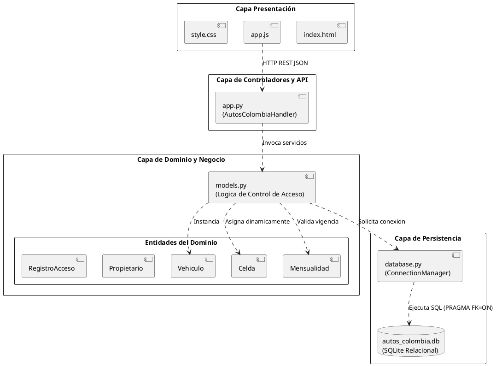
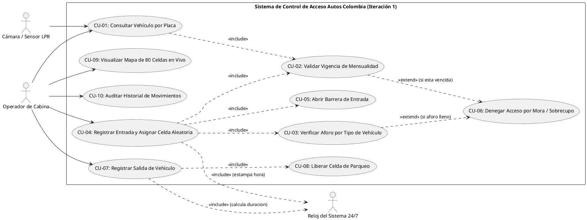
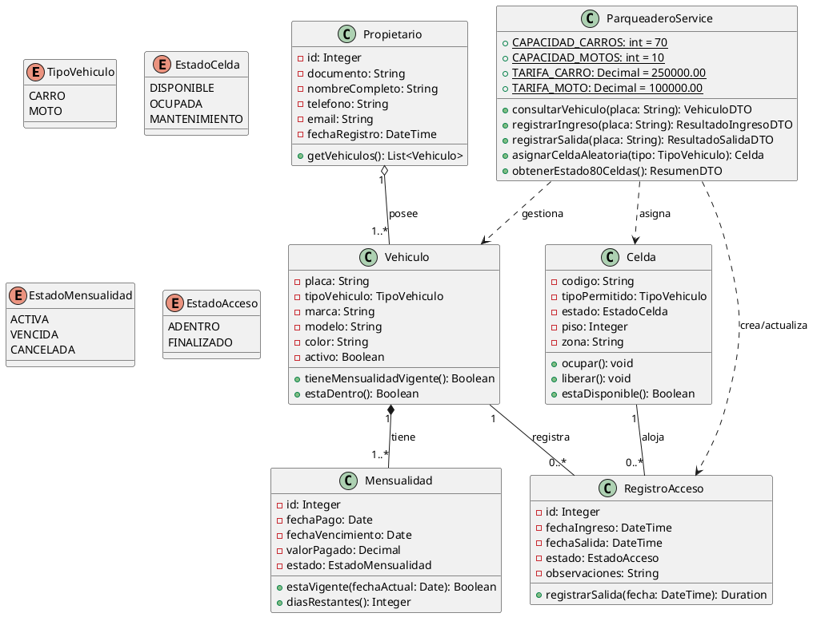
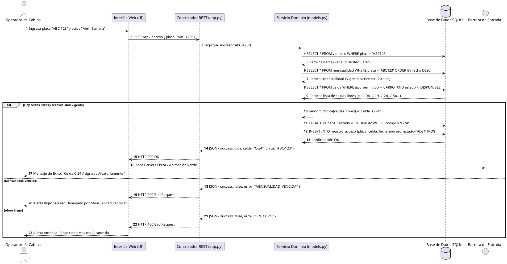
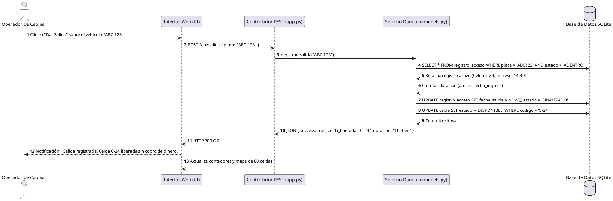
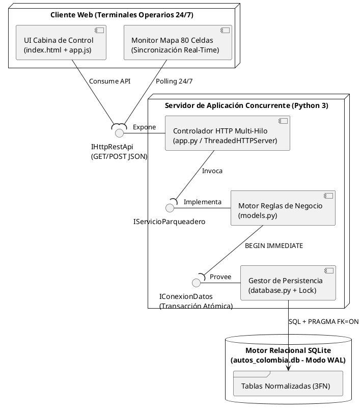
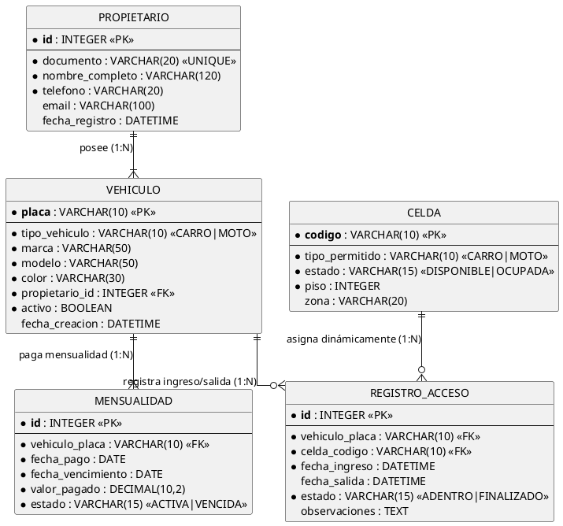

# PARQUEADERO AUTOS COLOMBIA 24/7
## MODELADO ORIENTADO A OBJETOS Y ARQUITECTURA DEL SISTEMA (STARUML)
### ITERACIÓN 1: CONTROL DE ENTRADA Y SALIDA
**Docente:** Reinaldo Rojas

---

Este documento contiene la especificación formal de la arquitectura de software y los diagramas UML solicitados para la entrega de la **Iteración 1**. Los diagramas están desarrollados en sintaxis estándar **PlantUML**, compatible directamente con herramientas de modelado como **StarUML**, Visual Paradigm, y editores PlantUML/Mermaid.

---

## 1. ARQUITECTURA DEL SISTEMA (ARQUITECTURA EN CAPAS)

El sistema adopta una arquitectura desacoplada en tres capas principales (**3-Tier Layered Architecture**):

1. **Capa de Presentación (Frontend SPA / UI):**
   - Interfaz web responsiva basada en el sistema de diseño industrial *Cobalt Bay OS*.
   - Consumo asíncrono de API REST vía Fetch API (`app.js`, `index.html`).
   - Gestión reactiva del mapa de 80 celdas y reloj operativo 24/7.
2. **Capa de Lógica de Negocio y Controladores (Backend / Application Layer):**
   - Servidor HTTP y API REST (`app.py`).
   - Servicios del dominio (`models.py`): Reglas de negocio de mensualidades, cálculo de tiempos, control de aforo y algoritmo de asignación aleatoria/dinámica de celdas.
3. **Capa de Datos y Persistencia (Data Layer):**
   - Motor relacional SQLite (`autos_colombia.db`).
   - Módulo de conexión y transacciones (`database.py`).
   - Esquema físico con claves foráneas e integridad referencial (`database_schema.sql`).

```
+-------------------------------------------------------------+
|               CAPA DE PRESENTACIÓN (UI / FRONTEND)          |
|  - index.html (Tailwind CSS, Plus Jakarta Sans, JetBrains)  |
|  - app.js (Controlador de eventos, Mapa reactivo de celdas) |
+-------------------------------------------------------------+
                              |  (HTTP REST / JSON)
                              v
+-------------------------------------------------------------+
|             CAPA DE NEGOCIO Y API (BACKEND PYTHON)          |
|  - AutosColombiaHandler (app.py): Enrutador REST API        |
|  - ParqueaderoService (models.py): Lógica de Dominio        |
|    * Validador de Mensualidad y Restricción de Mora         |
|    * Algoritmo de Asignación Aleatoria de Celdas            |
|    * Gestor de Aforo (70 Carros / 10 Motos)                 |
|    * Controlador de Apertura/Cierre de Barrera              |
+-------------------------------------------------------------+
                              |  (SQL Queries / Transacciones)
                              v
+-------------------------------------------------------------+
|               CAPA DE PERSISTENCIA (BASE DE DATOS)          |
|  - database.py: Pool de conexiones y DDL Inicializador      |
|  - autos_colombia.db (SQLite3 Relacional)                   |
|    [propietario] 1--* [vehiculo] 1--* [mensualidad]         |
|    [celda] 1--* [registro_acceso] *--1 [vehiculo]           |
+-------------------------------------------------------------+
```

---

## 2. DIAGRAMA DE PAQUETES (PACKAGE DIAGRAM)

Representa la organización modular del código fuente:



---

## 3. DIAGRAMA DE CASOS DE USO (USE CASE DIAGRAM)

Actores involucrados:
- **Operador de Cabina (Actor Principal):** Personal en turno 24/7 encargado de ingresar placas y operar las barreras.
- **Sensor / Cámara LPR (Actor Secundario):** Dispositivo de lectura óptica de placa vehicular.
- **Reloj de Sistema 24/7 (Actor de Sistema):** Provee el timestamp exacto.



---

## 4. DIAGRAMA DE CLASES (CLASS DIAGRAM)

Modela las clases del dominio, atributos con tipos de datos, visibilidad y relaciones con multiplicidad:



---

## 5. DIAGRAMAS DE SECUENCIA (SEQUENCE DIAGRAMS)

### 5.1 Secuencia de Entrada (Ingreso con Validación y Asignación Aleatoria)



### 5.2 Secuencia de Salida (Egreso y Liberación Automática de Celda)



---

## 6. DIAGRAMA DE ARQUITECTURA DE COMPONENTES E INTERFACES DE COMUNICACIÓN

Representa los componentes de software ejecutables y las interfaces provistas/requeridas mediante las cuales se comunican (incluyendo soporte multi-operario concurrente):



---

## 7. DIAGRAMA ENTIDAD-RELACIÓN Y MODELO RELACIONAL (BASE DE DATOS)



---

## 8. INSTRUCCIONES DE APERTURA EN STARUML

1. Abrir **StarUML**.
2. Seleccionar `File -> Open...` y elegir el archivo nativo **`docs/Autos_Colombia_StarUML.mdj`** incluido en esta carpeta.
3. También dispone de todos los diagramas exportados en alta resolución en `docs/diagramas/` (formatos `.png` y `.svg`) y el código fuente `.puml` en `docs/staruml_diagrams.puml`.
